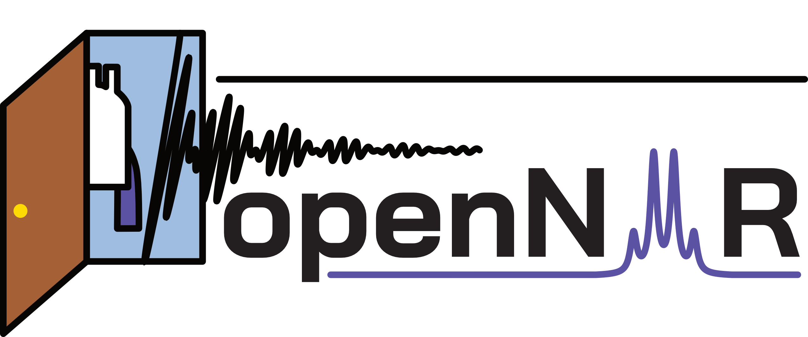

Vendor-agnostic NMR import, processing, plotting, and a desktop GUI.

Every vendor importer reads raw acquisition data (not a vendor's own
pre-processed output) and produces the same `NMRSpectrum` object, which
the same processing and plotting code then operates on. Currently
supported: Bruker (TopSpin `fid`/`ser`), X-Pulse (JCAMP-DX FID, including
arrayed/PFG experiments), Varian/Agilent (`fid`/`procpar`), JEOL Delta
(`.jdf`, 1D only so far).

## Layout

- `opennmr.core` — vendor-agnostic data model (`NMRSpectrum`, `NMRAxis`,
  `NMRMetadata`) and nucleus/gyromagnetic-ratio lookups.
- `opennmr.io` — per-vendor readers, all producing `NMRSpectrum`.
- `opennmr.processing` — FID processing (apodization, FFT, phasing),
  VOCS, spectrum arithmetic, 2D slice extraction, peak fitting,
  relaxation and diffusion fitting, PFG b-values and gradient
  calibration, DOSY by inverse Laplace transform, and multivariate
  component resolution (SCORE/OUTSCORE).
- `opennmr.plotting` — matplotlib plotting, `ax`-first so it embeds
  cleanly in a GUI canvas as well as standalone notebook figures.
- `opennmr.gui` — PySide6 desktop shell.

## Install (editable, into an existing environment)

```
pip install -e ".[test]"
```

## Run the GUI

```
opennmr-gui
```

## Run tests

```
pytest
```

## Getting good data for diffusion and relaxation analysis

The analysis methods in this package differ enormously in how much they
ask of the data, and **the demanding ones fail quietly**: they return a
confident-looking answer with an excellent fit statistic. This section
is what each one actually needs. The GUI repeats the essentials in the
relevant dialogs.

### The single most important thing

**Fit quality does not tell you whether a multivariate resolution is
right.** Measured directly on synthetic mixtures in this repository's
own test suite: an OUTSCORE run whose diffusion coefficients were **69%
wrong** reported R² = 0.99940, against 0.99937 for the run that got them
right. The error surface really is that flat — wildly different answers
reproduce the data equally well. A good R² means "this many components
can fit", never "these are the right components".

This is why `processing.score` reports cross-talk alongside R², warns
when the two methods disagree while fitting equally well, and says in
its own report which number the run actually optimised.

### Acquisition

| | Peak-by-peak fit | DOSY (ILT) | SCORE / OUTSCORE |
|---|---|---|---|
| Gradient levels / delays | 8+ | 12+ | 8–10 minimum, 15+ preferred |
| Attenuation of the fastest component | to ~20% | to ~5% | to ~10% |
| Phase / baseline | helps | required | required |
| Resolves overlapped peaks | no | no | yes |

* **Sample the decay, don't just start it.** A component that loses
  only 20% of its intensity across the whole series is nearly a
  constant, and its decay constant is poorly determined no matter how
  good the fit looks. There is a test in `tests/test_score.py` pinning
  this down: a component attenuating by 8% is recovered only to within
  a factor, which is a property of the experiment and not of the
  algorithm. The fix is a longer diffusion time or stronger gradients.
* **Space the levels sensibly.** Equal steps in *b* (equal steps in
  gradient *squared*) sample a decay far better than equal steps in
  gradient amplitude, which crowds points into the undecayed start.
* **Keep signal-to-noise up on the last levels too**, not just the
  first. The most-attenuated points carry most of the information about
  the slow components.
* **Don't let peaks move.** A bilinear model — the assumption behind
  SCORE, OUTSCORE and DOSY alike — says each component has one fixed
  spectrum. A peak that drifts across the series (temperature,
  exchange, referencing) breaks that, and shows up as a spurious extra
  component rather than as an error.

### Processing, before any of these methods

1. **Phase properly, in absorption mode.** Non-negativity is the single
   most stabilising constraint available to SCORE, OUTSCORE and the
   ILT, and it means nothing on a dispersive spectrum.
2. **Baseline-correct.** A rolling baseline is not a non-negative
   superposition of component spectra; it will be absorbed into
   whichever component can best accommodate it.
3. **Reference consistently across the series.**
4. **Use real b-values.** The GUI refuses to run DOSY or SCORE when the
   x-axis has fallen back to plain slice indices, because the resulting
   "diffusion coefficients" would be in no physical unit while being
   labelled m²/s. Either read them from a Bruker `diff.xml`, or supply
   δ/Δ/gradient and let `processing.diffusion.b_value` compute them —
   and get the **gradient shape factor** right: treating a stock Bruker
   `SMSQ10` sequence as a perfect rectangle overestimates *b* by 23%,
   which lands directly on D.
5. **Calibrate the gradient if you don't know it.** A maximum gradient
   10% wrong makes every D **21%** wrong, with nothing in the fit to
   show for it. `Analysis ▸ Calibrate Gradient…` measures it from a
   standard of known D.
6. **Check the gradient axis.** A probe's maximum gradient is saved per
   axis, because the three coils of a triple-axis probe are rarely the
   same strength — one number shared between them quietly rescales
   every D measured on the other two. Set the axis alongside the
   maximum; "Save gradient for probe" then stores that axis's value
   and leaves the others alone. It is the same setting the Imaging tab
   shows, and the same number: one experiment, one coil, one maximum.

### Choosing a method

* **One clean, well-separated peak per species** → ordinary curve
  fitting (`Analysis ▸ Curve Fitting`). It is the only one of these
  that gives a diffusion coefficient with a meaningful uncertainty.
* **Peaks belonging to the same molecule** → tick *Fit all peaks
  together* and share D. Fitting separately and averaging understates
  the uncertainty.
* **Overlapped peaks, species differing ≳30% in D** → **SCORE**.
* **Overlapped peaks, species differing by only a few percent in D** →
  **OUTSCORE**, which minimises cross-talk rather than residual. It
  separates down to ~3% where SCORE needs ~30% — but it assumes the
  components have genuinely *different* peaks. For species that legitimately
  share most of their resonances, minimising overlap pushes toward
  something untrue; the report warns when that has happened.
* **Unknown number of components, or a continuous distribution** →
  the **DOSY map** (`Analysis ▸ DOSY Map (ILT)`). Treat peak *positions*
  as the result and peak *widths* as an artefact of the regularisation.

Both `SCORE`/`OUTSCORE` and the curve fits take the **number of
components as an input, not an output**. Run at one more and one fewer
and prefer the answer whose component spectra look like plausible,
separate molecules.
